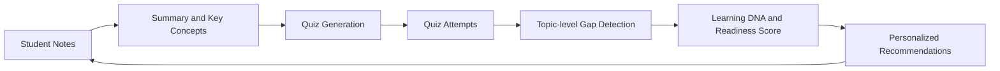

# LearnLens-AI
AI-powered Personalized Learning Intelligence Platform
<h1 align="center">LearnLens AI</h1>

<p align="center">
  <b>See how you learn. Fix what holds you back.</b><br/>
  An AI-powered personalized learning intelligence platform built on the Google Gemini API.
</p>

<p align="center">
  
  
  
  
  
</p>

---

## Why LearnLens AI?
## Why LearnLens AI?

I built LearnLens AI because of my own experience with self-study. When you study alone, it is easy to feel unsure: *Did I really understand this topic? What should I revise next? Am I even ready for the exam?* As someone who learns at my own pace, I often wished for a tool that would patiently show me where I stood instead of just handing me more material.

Most study tools stop at summarizing notes. Students still don't know **which topics they truly understand**, **where their gaps are**, or **what to study next**.

LearnLens AI closes that loop. It turns raw notes into quizzes, measures performance topic by topic, and builds a living profile of the learner, called the **Learning DNA**, that drives every recommendation. My goal is a tool that makes self-learners feel guided and supported, not overwhelmed, so that many students like me can study with more clarity and confidence.


## Core Features

| # | Feature | What it does |
|---|---------|--------------|
| 1 | **Smart Notes** | Summarizes notes and extracts key concepts with Gemini |
| 2 | **Auto Quiz Generation** | Creates quizzes directly from your own notes |
| 3 | **Gap Detection** | Finds weak topics from quiz performance |
| 4 | **Study Recommendations** | Suggests what to revise next, in priority order |
| 5 | **Exam Readiness and Learning DNA** | Scores readiness and profiles strengths, weaknesses, and knowledge gaps |

## The Learning DNA

The Learning DNA is a per-student profile that updates as the student learns:

- **Exam readiness score**: an overall measure of preparedness
- **Strong topics**: what the student has mastered
- **Weak topics and knowledge gaps**: where to focus
- **Recommended actions**: the next best steps

## How It Works



## Tech Stack

| Layer | Technology |
|-------|------------|
| Frontend | React.js, Tailwind CSS, React Router, Lucide React |
| Backend | Node.js, Express.js |
| Database | MongoDB with Mongoose |
| AI Engine | Google Gemini API |
| Authentication | JWT, bcryptjs |

## Project Structure

```
LearnLens-AI/
├── docs/          # Architecture, workflow, roadmap, problem statement
├── backend/       # Express API, models, controllers, routes, middleware
└── frontend/      # React application
```

## Documentation

- [Project Overview](docs/project-overview.md)
- [Problem Statement](docs/problem-statement.md)
- [System Architecture](docs/System-Architecture.md)
- [AI Workflow](docs/AI-Workflow.md)
- [Feature Roadmap](docs/Feature-roadmap.md)

## Getting Started

### Prerequisites

- Node.js 18 or later
- A MongoDB database (local or MongoDB Atlas)
- A Google Gemini API key

### Run the backend

```bash
git clone https://github.com/prarthona540/LearnLens-AI.git
cd LearnLens-AI/backend
npm install
cp .env.example .env
npm run dev
```

Fill `.env` with your own values:

```
PORT=5000
MONGO_URI=your_mongodb_connection_string
JWT_SECRET=your_long_random_secret
GEMINI_API_KEY=your_gemini_api_key
```

Then verify the server at `http://localhost:5000/api/health`.

## Roadmap

- [x] Project vision, architecture, and documentation
- [ ] Backend foundation and authentication
- [ ] Notes module with Gemini summarization
- [ ] Quiz generation and scoring
- [ ] Gap detection and Learning DNA engine
- [ ] React frontend and dashboard
- [ ] Deployment

## Engineering Principles

- Modular code: routes, controllers, services, and models are kept separate
- Secrets stay in environment variables, never in the repository
- Every feature ships in a small, well-described commit

## Author

Built by [@prarthona540](https://github.com/prarthona540) as a portfolio project and a potential startup MVP.

## License

MIT License